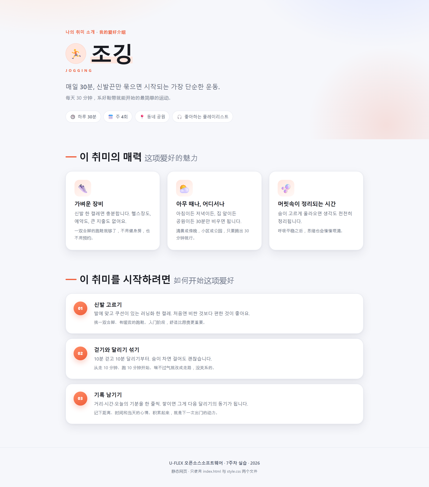
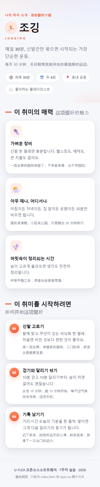
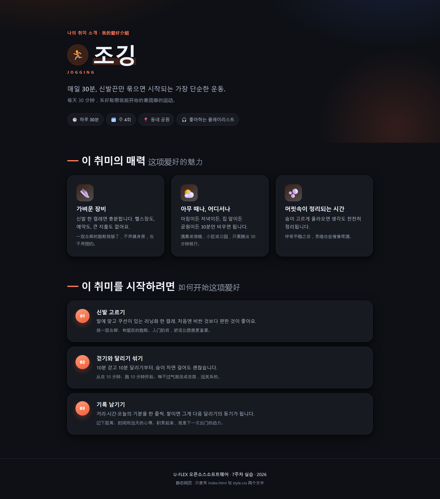

# 조깅 · 나의 취미 소개 / 慢跑 · 我的爱好介绍

> U-FLEX 오픈소스소프트웨어 7주차 오프라인 실습 — 정적 홈페이지 제작
> U-FLEX 开源软件 第 7 周线下实践 — 静态网页制作（韩中双语）

나의 취미인 **조깅**을 소개하는 한 페이지짜리 정적 웹사이트입니다.
介绍我的爱好——**慢跑**的单页静态网站。

🔗 **웹에서 바로 보기 / 在线预览:** <https://t7oo7t.github.io/uflex-week7-jogging/>
（GitHub Pages 배포본 · 로컬에서는 `index.html`을 더블클릭해도 동일하게 열립니다.）

---

## 1. 작품 소개 / 作品介绍

| 항목 / 项目 | 내용 / 内容 |
| --- | --- |
| 작품명 / 作品名 | 조깅 · 나의 취미 소개 (慢跑 · 我的爱好介绍) |
| 유형 / 类型 | 정적 홈페이지 (HTML + CSS) / 静态网页 |
| 주제 / 主题 | 취미 소개 — 조깅 / 爱好介绍——慢跑 |
| 제작 / 制作 | AI 바이브 코딩 (코드 생성 후 브라우저에서 직접 검증) |
| 기술 / 技术 | HTML5, CSS3 — JavaScript·프레임워크·외부 라이브러리 없음 |

한 줄 소개 / 一句话介绍

> 매일 30분, 신발끈만 묶으면 시작되는 가장 단순한 운동.
> 每天 30 分钟，系好鞋带就能开始的最简单的运动。

---

## 2. 실행 방법 / 运行方法

1. 저장소를 내려받습니다. (Code → Download ZIP, 또는 `git clone`)
2. **`index.html` 파일을 더블클릭**합니다.

- 설치, 서버 실행, 로그인, 패키지 설치가 모두 필요 없습니다.
- 인터넷에 연결되어 있지 않아도 그대로 열립니다. (외부 폰트·CDN·이미지 요청 없음)
- 无需任何安装：双击 `index.html` 即可在浏览器中打开，断网也能正常显示。

---

## 3. 파일 구조 / 文件结构

```
index.html                 # 페이지 구조 (마크업)
style.css                  # 디자인 · 반응형 레이아웃
screenshots/
  ├─ desktop-1440.png      # PC 폭(1440px) 실행 화면
  ├─ mobile-390.png        # 모바일 폭(390px) 실행 화면
  ├─ desktop-1440-dark.png # (참고) 다크 모드
  └─ mobile-390-dark.png
README.md
```

> 웹사이트 자체는 **`index.html`, `style.css` 두 파일만**으로 동작합니다.
> `screenshots/`와 `README.md`는 검증 결과와 제출용 문서입니다.
> 网站本身仅由 `index.html` 与 `style.css` 两个文件构成；`screenshots/` 与 `README.md` 属于验证材料。

---

## 4. 주요 기능 / 主要功能

| # | 요구사항 / 要求 | 구현 / 实现 |
| --- | --- | --- |
| ① | 제목 + 취미 한 줄 소개 / 标题与一句话介绍 | `조깅` 대제목, `JOGGING` 라벨, 한 줄 소개 + 중국어 병기, 요약 칩 4개 |
| ② | 사진 대신 이모지 카드 3장 / 3 张 Emoji 卡片 | 👟 가벼운 장비 · ⛅ 아무 때나 어디서나 · 🫧 머릿속이 정리되는 시간 |
| ③ | "이 취미를 시작하려면" 3단계 안내 / 三个步骤 | 01 신발 고르기 → 02 걷기와 달리기 섞기 → 03 기록 남기기 |
| + | 모바일에서 글자가 잘리지 않을 것 / 手机端不截断 | `clamp()` 유동 타이포그래피, `auto-fit` 그리드, 320px까지 검증 |
| + | 추가 / 附加 | 다크 모드(`prefers-color-scheme`), 키보드 포커스 링, `prefers-reduced-motion` 대응 |

---

## 5. 실행 화면 / 运行截图

### PC 화면 — 1440 × 900


### 휴대폰 화면 — 390 × 844


### (참고) 다크 모드 / 深色模式


---

## 6. 검증 결과 / 验证结果

헤드리스 Chrome(Chromium 158)으로 8개 폭에서 측정했습니다. 모든 폭에서 **가로 스크롤·요소 넘침·텍스트 잘림이 0건**입니다.
使用 headless Chrome 在 8 种宽度下测量：**没有横向滚动、没有元素溢出、没有被截断的文字**。

| Viewport | 가로 스크롤 / 横向滚动 | 넘친 요소 / 溢出元素 | 잘린 텍스트 / 截断文字 | 페이지 높이 |
| --- | --- | --- | --- | --- |
| 320 × 640 | 없음 | 0 | 0 | 2058 px |
| 360 × 740 | 없음 | 0 | 0 | 1993 px |
| 390 × 844 | 없음 | 0 | 0 | 1881 px |
| 414 × 896 | 없음 | 0 | 0 | 1860 px |
| 768 × 1024 | 없음 | 0 | 0 | 1590 px |
| 1024 × 768 | 없음 | 0 | 0 | 1616 px |
| 1440 × 900 | 없음 | 0 | 0 | 1633 px |
| 1920 × 1080 | 없음 | 0 | 0 | 1633 px |

검증 방법 / 验证方法: `document.documentElement.scrollWidth === innerWidth` 확인 + 모든 요소의 `getBoundingClientRect()`가 뷰포트를 벗어나는지 검사 + 모든 텍스트 요소의 `scrollWidth > clientWidth`(잘림) 검사.

---

## 7. 구현 메모 / 实现说明

- **외부 의존성 0** — CDN, 웹폰트, 이미지 파일, JavaScript를 사용하지 않습니다. 이모지는 운영체제 기본 폰트로 렌더링됩니다.
- **유동 타이포그래피** — 모든 글자 크기를 `clamp(최소, 선호, 최대)`로 지정해 320px에서도 제목이 넘치지 않고, 큰 화면에서는 과도하게 커지지 않습니다.
- **레이아웃** — 카드는 `grid-template-columns: repeat(auto-fit, minmax(min(100%, 15.5rem), 1fr))`로, 좁은 화면에서는 1열, 넓은 화면에서는 3열로 자연스럽게 바뀝니다.
- **줄바꿈** — 한국어는 `word-break: keep-all`(단어 단위), 중국어는 `word-break: normal`, 넘치는 긴 단어는 `overflow-wrap: break-word`로 잘리지 않고 다음 줄로 넘어갑니다.
- **접근성** — 시맨틱 태그(`header`/`main`/`section`/`footer`), `lang` 속성(ko / zh-CN), 장식 이모지에 `aria-hidden`, 키보드 포커스 표시.

---

## 8. 참고 / 备注

- 웹사이트 배포(GitHub Pages)는 선택 사항이며, 이 저장소는 **저장소 URL 제출**만으로 평가 가능하도록 구성했습니다.
- 교육용 실습 결과물입니다. / 本项目为课程练习作品。
